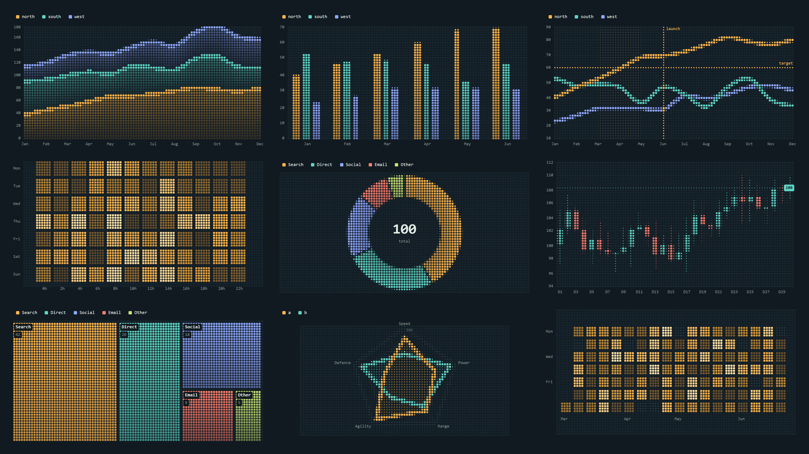
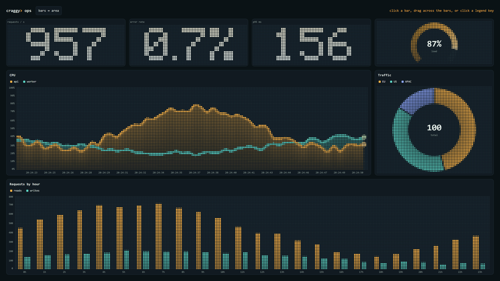

<picture>
  <source media="(prefers-color-scheme: dark)" srcset="docs/assets/craggy-wordmark-on-dark.svg">
  
</picture>

# Craggy Charts

Charts drawn in the Craggy tile grid, from the rounded squares of the logo and the website's terrain animation.
There is one flat options object with good defaults. Tiles spring into place as data changes. The API is the
same in JavaScript, Flutter and Python.

<p align="center">
  <a href="docs/index.html">
    
  </a>
</p>

## Features

- **24 chart types in v1:** `line` `area` `bar` `histogram` `scatter` `bubble` `range` `candlestick` `ohlc`
  `boxplot` `waterfall` `heatmap` `calendar` `pie` `donut` `gauge` `radialBar` `radar` `rose` `waffle`
  `treemap` `funnel` `progress` `stat`, plus combos through `layers`.
- **One flat options object:** [every option](docs/options.md) has a default, and `update()` morphs between any
  two configurations, including a change of type.
- **Configurable tiles:** a tile's size is how much of it the shape covers, so edges anti-alias. Tile size
  (`cell`), `gap` and corner radius (`round`) are options, and charts are responsive.
- **Live data:** `push`, `patch` and a scrolling `window`, with tiles springing into place at constant speed.
- **Fast:** one shared WebGL2 context with a Canvas2D fallback, no cost once settled, and M4 decimation so a
  million points draw interactively. The JS bundle is about 38 KB gzipped.
- **Interaction and accessibility built in:** tooltips, crosshair, legend toggling, touch, keyboard navigation,
  screen-reader summaries and data tables, and `prefers-reduced-motion`.
- **Identical everywhere:** the JS and Dart cores reproduce the same [conformance fixtures](conformance)
  tile for tile, and the Python widget runs the JS core.

## Packages

| Package | Where | Install |
|---|---|---|
| [`js/`](js) | npm `craggy-charts`: core, WebGL2 + Canvas2D renderers, React, `<craggy-chart>` | `npm install craggy-charts` |
| [`flutter/`](flutter) | pub.dev `craggy_charts`: Dart core and a `drawRawAtlas` painter (mobile, desktop, web) | `flutter pub add craggy_charts` |
| [`python/`](python) | PyPI `craggy-charts`: Jupyter widget (anywidget), static HTML, Streamlit | `pip install craggy-charts` |

```js
chart('#sales', { type: 'bar', data: sales, x: 'month', stack: true, format: 'currency' })
```
```dart
CraggyChart(type: ChartType.bar, data: sales, x: 'month', stack: true, format: 'currency')
```
```python
cc.chart(sales_df, type="bar", x="month", stack=True, format="currency")
```

## Examples

<p align="center">
  <a href="examples/js/live-dashboard.html">
    
  </a>
</p>

The [live dashboard](examples/js/live-dashboard.html) above is one HTML file: download the repository, build the
JS package and open the file in a browser.

| Example | Shows |
|---|---|
| [HTML quickstart](examples/js/quickstart.html) | A plain HTML page: one `<script>` tag and one chart, no build step. |
| [Live dashboard](examples/js/live-dashboard.html) | Stats, a gauge, live data with `push()`, morphing with `update()`, and events. |
| [Web component](examples/js/web-component.html) | `<craggy-chart>` with options as HTML attributes. |
| [Terminal](examples/js/terminal.mjs) | The headless core in Node, printed to the terminal. |
| [Jupyter notebook](examples/python/notebook.ipynb) | Widgets, events back into Python, live data and HTML export. |
| [Static report](examples/python/report.py) | Three charts in one self-contained HTML file. |
| [Streamlit app](examples/python/streamlit_app.py) | Charts with Streamlit controls. |
| [Flutter app](flutter/example) | A gallery of every type, a live chart and a theme toggle. |

The HTML examples open straight from disk once the JS package is built (`cd js && npm install && npm run build`).
More detail is in [examples/README.md](examples/README.md).

## Layout

* [`spec/`](spec): the options schema and design tokens. These are the single source of truth.
  `spec/generate.mjs` writes the TypeScript, Dart and Python definitions and
  [`docs/options.md`](docs/options.md).
* [`conformance/`](conformance): fixtures and the expected tile field for each one. The JS and Dart cores must
  both reproduce every field (±1 per channel) and every label.
* [`docs/index.html`](docs/index.html): live gallery of every type, with interaction demos. Serve the
  repository root and open `/docs/index.html`.
* [`examples/`](examples): small runnable examples: a script-tag quickstart, a live dashboard, the web
  component, the headless core in a terminal, a Jupyter notebook, a static report and a Streamlit app.
* The images in this README are rendered at 4K by `npm run gallery` in `js/`.

## Tests

```bash
cd js && npm install && npm run build && npm test && npx playwright test
cd flutter && flutter test
cd python && node build.mjs && uv run pytest
```

MIT licence.
